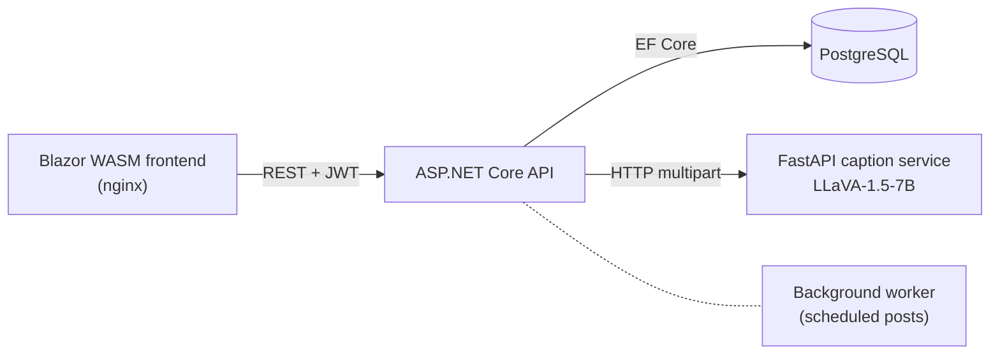

# AI Caption Generator

A full-stack app that writes social-media captions for your images. Upload a photo, get a caption generated by the **LLaVA-1.5-7B** vision-language model, edit it, and schedule the post for Facebook or Instagram.

**Stack:** C# / ASP.NET Core · Blazor WebAssembly · Python / FastAPI · PyTorch + Hugging Face Transformers · PostgreSQL · Docker · Azure Container Apps · Bicep · GitHub Actions

## Architecture



| Service | Folder | Description |
|---|---|---|
| Web | `CaptionGenerator.Web` | Blazor WebAssembly SPA served by nginx: landing page, login/register, dashboard, post editor |
| API | `CaptionGenerator.API` | REST API (`/api/v1/...`) with JWT auth (ASP.NET Identity), image upload, post CRUD and scheduling |
| Caption service | `caption-service` | FastAPI service running LLaVA on GPU (CUDA, fp16) with automatic CPU fallback |
| Database | — | PostgreSQL, schema managed with EF Core migrations applied on startup |

The .NET backend follows **Clean Architecture**:

- `CaptionGenerator.Domain`: the `Post` entity and its state transitions (`Scheduled → PendingConfirmation → Published / Canceled`)
- `CaptionGenerator.Application`: CQRS commands and queries with **MediatR**, validated by a **FluentValidation** pipeline behavior
- `CaptionGenerator.Infrastructure`: EF Core `DbContext`, migrations, repositories
- `CaptionGenerator.API`: controllers, exception-handling middleware, caption-service client, and a hosted `BackgroundService` that moves due scheduled posts to pending confirmation

### Caption service details

- The model loads in a background thread at startup (double-checked locking), so the service accepts requests and reports health immediately.
- `GET /health` reports `status` (`starting` / `ready`), the model name, the device (`cuda:0` / `cpu`) and the last load error, if any.
- `POST /generate-caption-upload` (multipart image) and `POST /generate-caption` (image URL) return `{ "caption": "..." }`.
- The output is cleaned up: role-prefix stripping, capitalization and punctuation, length limited to 280 characters.

## Running locally

Requirements: Docker Desktop. An NVIDIA GPU with ≥16 GB VRAM is recommended; without one, the caption service falls back to CPU, which is very slow for a 7B model.

```bash
docker compose up --build
```

| URL | Service |
|---|---|
| http://localhost:3000 | Web app |
| http://localhost:5000/health | API health |
| http://localhost:8000/health | Caption service health |

The first start downloads the model (~14 GB) into a Docker volume, so it takes a few minutes before the caption service reports `ready`. Configuration defaults are in `.env`. They are development-only values.

## Tests

```bash
dotnet test CaptionGenerator.Tests.Unit          # 61 unit tests (xUnit + Moq)
dotnet test CaptionGenerator.Tests.Integration   # 30 API integration tests (WebApplicationFactory + Testcontainers PostgreSQL, needs Docker)
cd caption-service && pytest                     # caption service tests
```

GitHub Actions (`.github/workflows/ci-cd.yml`) builds the solution and runs the unit and integration tests against PostgreSQL on every push and pull request. Pushes to `main` also build and publish the API Docker image to GitHub Container Registry.

## Azure deployment

The app was deployed to **Azure Container Apps** (West Europe) in May 2026. All infrastructure is defined in [`azure/infrastructure.bicep`](azure/infrastructure.bicep):

- Azure Container Registry for the three images
- Container Apps environment with three apps (web, API, caption service), each with liveness probes on its health endpoint and autoscaling
- Azure Database for PostgreSQL Flexible Server
- Log Analytics workspace collecting container logs

`azure/Deploy-Azure.ps1` (or `azure/deploy.sh`) provisions the resources, builds and pushes the images, and deploys them.

**GPU note:** the student subscription had zero GPU quota (Azure Container Instances rejected V100 requests with `ContainerGroupQuotaReached`). For demos, the caption service ran on a local GPU and the Azure-hosted API was pointed at it through a tunnel (`update-azure-to-local.ps1`). Scripts for running it on a GPU VM instead are in `azure-deploy-gpu-vm*.ps1`.

The deployment has since been shut down.
